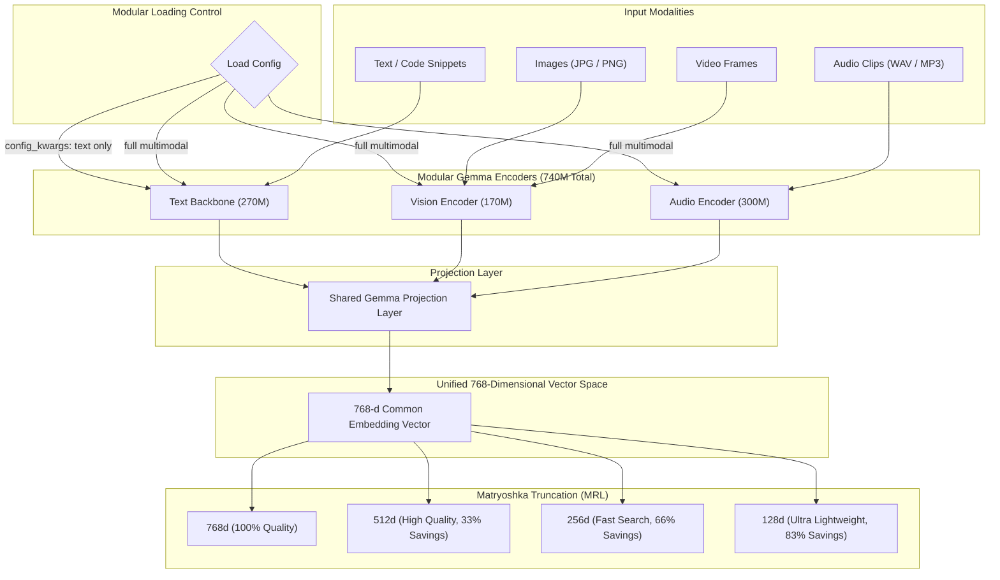
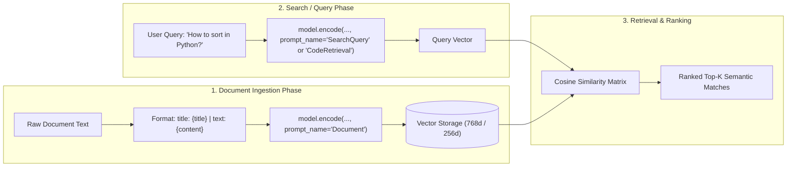

# 🌟 Google DeepMind EmbeddingGemma 2 (`google/embeddinggemma-2`)

Complete interactive test suite and conceptual guide for **EmbeddingGemma 2**, Google DeepMind's open, natively multimodal embedding model released under the **Apache 2.0 License** (ungated on Hugging Face).

---

## 📑 Table of Contents
1. [Architecture Overview](#-architecture-overview)
2. [Flow Diagrams](#-flow-diagrams)
3. [Key Concepts & Gotchas](#-key-concepts--gotchas)
4. [Optimized Git ↔ Google Colab Pro Bridge](#-optimized-git--google-colab-pro-bridge)
5. [Local Test Suite Walkthrough](#-local-test-suite-walkthrough)
6. [Interactive CLI Explorer](#-interactive-cli-explorer)

---

## 🏛️ Architecture Overview

| Specification | Details |
|---|---|
| **Base Model** | Gemma 4 Architecture |
| **Total Parameters** | **740 Million** (Modular design) |
| **Text Backbone** | **~270 Million** (Can be loaded independently for ~191MB RAM footprint) |
| **Vision Encoder** | **~170 Million** (Processes images & video frames) |
| **Audio Encoder** | **~300 Million** (Processes audio waveforms & speech) |
| **Embedding Dimension** | **768 Dimensions** (Unified shared vector space) |
| **Context Length** | **8,192 Tokens** |
| **Matryoshka Slicing** | **768d, 512d, 256d, 128d** |
| **License** | **Apache 2.0** (Open commercial, ungated on Hugging Face) |

---

## 📊 Flow Diagrams

### 1. Unified Multimodal Architecture & Modular Loading



---

### 2. Asymmetric Prompt Retrieval Pipeline



---

## ⚠️ Key Concepts & Gotchas

### 1. The Precision Rule (Never use FP16!)
> [!WARNING]
> Gemma architectures feature large activation dynamic ranges that **overflow in standard float16**, producing `NaN` or degraded vectors.
> - On **CPU**: Use `torch.float32`.
> - On **GPU**: Use `torch.bfloat16`.

### 2. Instruction Prompt Names
EmbeddingGemma 2 expects specific prompt instructions during encoding:
- `prompt_name="Document"`: For corpus documents. Recommended format: `title: {title} | text: {content}` (or `title: none | text: {content}`).
- `prompt_name="SearchQuery"`: For natural language retrieval queries.
- `prompt_name="CodeRetrieval"`: For finding code implementations and programming syntax.
- Multimodal inputs (images/audio) do **not** take a prompt prefix.

### 3. Matryoshka Representation Learning (MRL)
Embeddings can be truncated on the fly:
```python
# Save 66.7% memory in your vector database:
vector = model.encode("Your text", truncate_dim=256)
```

---

## ⚡ Optimized Git ↔ Google Colab Pro Bridge

```
[Local Machine / Antigravity] 
         │ 
         ▼ (git push)
  [GitHub Repository] ◄────────────────┐
         │                             │ (File -> "Save a copy in GitHub")
         ▼ (Open in Colab)             │
 [Google Colab Pro (A100 / L4 GPU)] ───┘
```

### Steps to Connect:
1. **Push your code to GitHub**:
   ```powershell
   git add .
   git commit -m "Initialize EmbeddingGemma 2 test suite and notebook"
   git remote add origin https://github.com/<your-username>/test-embedding-gemma2.git
   git branch -M main
   git push -u origin main
   ```
2. **Open in Colab Pro**:
   - Open `https://colab.research.google.com/github/<your-username>/test-embedding-gemma2/blob/main/EmbeddingGemma2_Complete_Guide.ipynb`
   - In Colab Pro, select **Runtime $\rightarrow$ Change runtime type $\rightarrow$ GPU (L4 or A100)**.
3. **Save Work Back to Local**:
   - In Colab: Click **File $\rightarrow$ Save a copy in GitHub**.
   - On local PC: Run `git pull`.

---

## 🚀 Local Test Suite Walkthrough

Install requirements:
```powershell
pip install -r requirements.txt
```

### 1. Quickstart Text Embedding
Loads lightweight 270M text backbone and generates similarity matrices:
```powershell
python 01_quickstart_text.py
```

### 2. Asymmetric Task Prompts
Demonstrates `SearchQuery`, `Document`, and `CodeRetrieval`:
```powershell
python 02_task_prompts_search.py
```

### 3. Matryoshka Benchmark
Measures vector storage reduction and similarity retention across 768d, 512d, 256d, and 128d:
```powershell
python 03_matryoshka_bench.py
```

### 4. Multimodal Image & Text Matching
Encodes visual features and natural language queries into the shared 768-d space:
```powershell
python 04_multimodal_image.py
```

---

## 💻 Interactive CLI Explorer

Test semantic search live from your terminal:
```powershell
python interactive_explorer.py
```
- Type queries in real-time.
- Switch between 768d and 256d using `dim 256` or `dim 768`.
- Type `exit` to quit.
